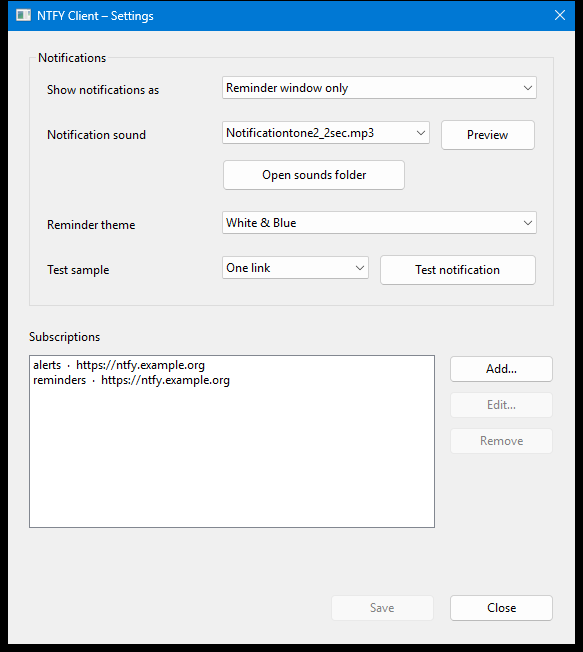
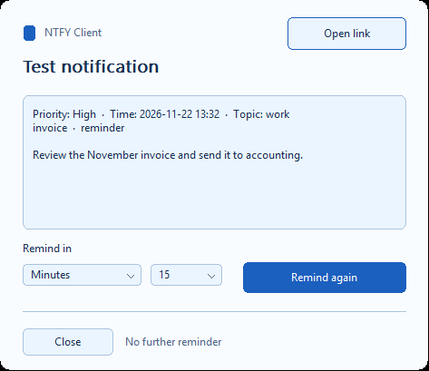
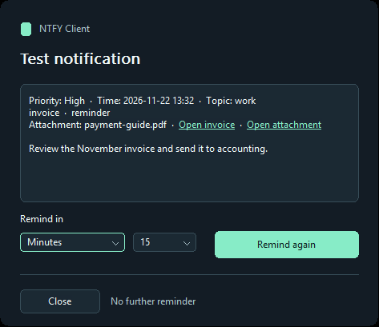
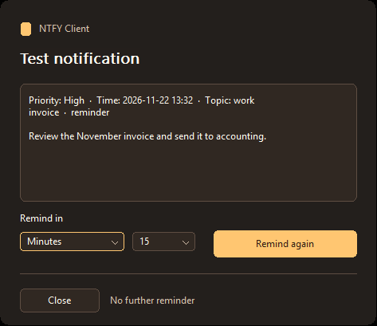

# NTFY Client

NTFY Client is a native Windows desktop client for self-hosted ntfy servers. It starts a single background receiver when you sign in and can display incoming messages as a Windows banner, a persistent reminder window, or both.

## Install and subscribe

1. Run [NTFY Client 0.2.3 Setup (x64)](bin/NTFY-Client-Setup-x64.exe) on Windows 10 version 2004 or later or Windows 11. The installer works per user and installs `NTFY-Client.exe` in `%LOCALAPPDATA%\Programs\NTFY-Client`.
2. Open **NTFY Client – Settings** from the Start menu. Click **Add…** and enter a server URL such as `https://ntfy.example.org` and a topic such as `alerts`.
3. For a private topic, enter an ntfy access token with read access to that topic. Token-authenticated subscriptions require HTTPS.
4. Click **Apply**, then **Save**. The client validates the settings and restarts the receiver. You can close Settings while it runs in the background.

You can add, edit, and remove multiple subscriptions, including subscriptions on different ntfy servers. The receiver starts without a console or tray icon and reconnects after a connection drops or the PC wakes. If the server caches messages, the running receiver can catch up after a disconnect.

## Settings

| Control | What it does |
| --- | --- |
| **Show notifications as** | Uses **Windows notification only**, **Reminder window only**, or **Both** for all subscriptions and due reminders. |
| **Notification sound** | Uses **Windows default** or one of the 35 bundled tones. It also lists any MP3 or WAV files you add. |
| **Preview** | Plays the selected tone so you can listen before saving. |
| **Open sounds folder** | Opens the installation's writable `sounds` folder in File Explorer. Copy an MP3 or WAV into it, then reopen the sound list. |
| **Reminder theme** | Sets the reminder window to **White & Blue**, **Midnight Mint**, or **Slate & Amber**. |
| **Test sample** and **Test notification** | Try an example with no link, one link, or multiple links using your current display mode, tone, and theme before saving. The test stays local and creates no scheduled reminder. |

When you use a custom tone with **Both**, the client plays it once and silences the accompanying Windows banner.



## Reminder window

The window shows the original title and message, plus the priority, local timestamp, topic, tags, and attachment information when available. A single web link appears as **Open link** in the header. Multiple web links appear as clickable links in the message area. Links can come from the message text, the ntfy click URL, a view action, or an attachment.

- **Close** dismisses the current reminder.
- **Remind again** schedules it locally for **1–60 Minutes, Hours, or Days**. The reminder keeps the message details and works independently of its subscription. Overdue reminders are shown when the receiver next runs or resumes, using the current display mode and sound.

If several reminders arrive together, the client shows them one at a time. The counter shows how many are waiting.

### Test notification previews

**White & Blue · One link** shows the **Open link** button in the header.



**Midnight Mint · Multiple links** shows an attachment and links in the message area.



**Slate & Amber · No link** shows the same message without link controls.



## Local data and Windows notifications

The client stores subscription settings in `%LOCALAPPDATA%\NtfyWindows\subscriptions.json`. Windows DPAPI encrypts access tokens for the signed-in Windows user. Scheduled reminders and their message details are stored separately in `%LOCALAPPDATA%\NtfyWindows\reminders.json`. You can remove these files after uninstalling if you want to discard the retained settings and reminders.

If notifications appear in Notification Center without a banner, check the NTFY Client settings under **Settings → System → Notifications** and check whether **Do not disturb** is on.

## Build from source

You need the Visual Studio 2022 x64 C++ Build Tools, a Windows SDK (tested with 10.0.26100.0), and Inno Setup 6.7 or later (tested with 6.7.4). Run this command from the repository root.

```powershell
.\src\build.cmd "C:\Path\to\Inno Setup 6\ISCC.exe"
```

The build uses C++17, Win32, WinHTTP, and C++/WinRT from the Windows SDK. The C++ runtime is linked statically. Intermediate files go to `..\.build\ntfy-client`, the bundled tones come from `src/sounds`, and the finished installer goes to `bin`.

[ntfy HTTP API](https://docs.ntfy.sh/subscribe/api/) · [Walzen's ntfy-toaster reference](https://github.com/Walzen-Group/ntfy-toaster) · [MIT license](LICENSE)

---

This is a vibe-coded project. Review the source code before compiling it.
